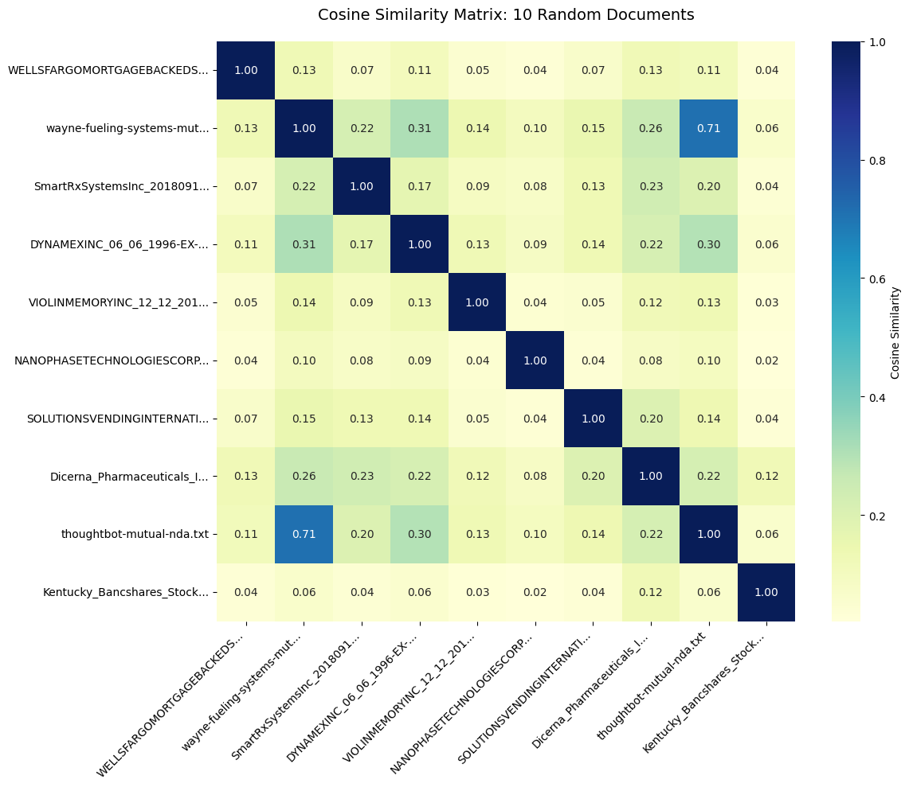

# Legal Document Q&A with Retrieval-Augmented Generation (RAG)

**Domain:** legal & compliance · **Type:** generative AI / RAG · **Stack:** LangChain, Chroma, Hugging Face sentence-transformers, Google Gemini, Ragas

[View notebook](rag_legal_documents.ipynb) · [Open in nbviewer](https://nbviewer.org/github/votmh256/huy-vo-ai-lab/blob/main/05-rag-legal-docs/rag_legal_documents.ipynb)

## Problem
Lawyers and compliance teams spend hours searching long contracts for specific clauses and obligations. The goal: build a RAG pipeline that answers natural-language questions about a corpus of legal agreements, grounded in the source text and showing which documents it used.

## Data
644 legal documents across four collections: NDAs and confidentiality agreements (ContractNLI), commercial contracts (CUAD), merger agreements (MAUD) and privacy policies (Privacy QA). Lengths range from a few hundred words to more than 150K words per document. The benchmark files contain 6,695 question–answer pairs.

## Approach
- **Loading and cleaning:** loaded all text files with their category metadata, then removed special characters, contact details and extra whitespace, normalised case and removed stop words.
- **EDA:** analysed document length by category, word frequencies, and TF-IDF cosine similarity between documents to spot near-duplicate clauses and templates.
- **Chunking:** split documents with LangChain's `RecursiveCharacterTextSplitter` (1,000 characters, 200 overlap), giving **55,318 chunks**.
- **Embeddings and vector store:** embedded the chunks with the open-source `all-MiniLM-L6-v2` model (no API cost) and indexed them in **Chroma** in batches of 1,000 to fit Colab memory.
- **RAG chain:** built a LangChain LCEL chain with a top-4 retriever, a prompt that tells the model to answer only from the retrieved context, and **Gemini Flash Lite**. A helper returns both the answer and its source documents.
- **Evaluation design:** set up Ragas (context precision, context recall, faithfulness) plus two retrieval metrics, hit rate@4 and mean reciprocal rank, on a random sample of benchmark questions.

## Results
- End-to-end pipeline working: for example, asking *"What are the obligations of the Receiving Party regarding Confidential Information?"* returns a structured answer covering protection duties, disclosure restrictions and permitted disclosure to representatives, along with the source contracts.
- The Ragas evaluation run hit a library/API compatibility error, so metric scores are not yet reported. [Rerun pending]

## What I'd do before production
- Get the evaluation running and track faithfulness and retrieval metrics on a fixed benchmark set, so every change to chunking, embeddings or prompts is measured.
- Test legal-domain embeddings and hybrid search (keyword plus vector), since legal clauses depend on exact terms.
- Add guardrails for a regulated setting: clause-level citations in every answer, an "I don't know" fallback when retrieval confidence is low, access controls on documents, and human review before any answer is relied on.
